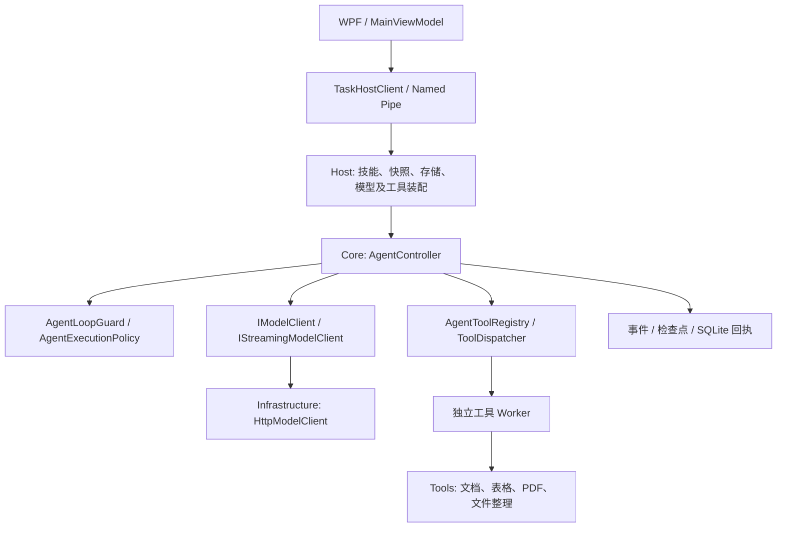

# 晓助手：Cline / OpenCode 架构研究与本轮实现

日期：2026-11-02。目标：在现有 WPF / .NET Framework 4.8 工程上改进 Agent 内核，保留 Win7 目标和现有模型配置。

## 1. 研究依据与结论

本轮实际阅读以下官方材料，而非仅依据项目介绍：

- [Cline SDK 架构](https://github.com/cline/cline/blob/main/sdk/ARCHITECTURE.md)：shared、llms、agents、core、应用的分层及运行流程。
- [Cline AgentRuntime 源码](https://github.com/cline/cline/blob/main/sdk/packages/agents/src/agent-runtime.ts)：模型请求准备、工具执行、运行控制和错误处理的职责组织。
- [Cline SDK 包职责](https://github.com/cline/cline/tree/main/sdk/packages)：模型适配、无持久化循环与有状态会话的边界。
- [OpenCode v1.1.20 SessionProcessor](https://github.com/anomalyco/opencode/blob/v1.1.20/packages/opencode/src/session/processor.ts)：工具调用状态、连续重复调用检测、权限和执行阶段事件。
- [OpenCode 工程目录](https://github.com/anomalyco/opencode/tree/dev/packages)：应用、核心、协议、模型等模块的组织。

Cline 的上述 main 链接是动态来源，未固定提交 SHA；OpenCode 的具体执行器参考固定为 v1.1.20，**不是宣称这是当前最新版本**。原先尝试读取 OpenCode dev 的旧 session 路径返回 404，因此没有把不存在的路径当作最新实现依据。终端 GitHub 连接受代理限制，未完整克隆两套仓库，也未完成逐文件审计。

采用的原则：分离模型适配、循环控制、工具执行和持久化；以明确的运行策略限定工具；在执行前识别异常循环；让已有事件和执行回执继续承担审计与恢复职责。

本轮是基于公开架构的 C# 独立实现，没有嵌入 Cline SDK、OpenCode 或复制其源码，也没有新增 Node/Bun 运行依赖。不是把两个项目合并成一个内核。未来若直接引入上游代码，需固定版本并保留对应许可和声明。

## 2. 对现有工程的判断

原工程已经具备多轮模型/工具循环、SSE、用户审批、SQLite 会话与回执、输入快照、成果校验、Host/Worker 隔离。应保留这些能力，不通过更换 UI 或运行时丢掉已有数据边界。

具体差距与本轮处理：

| 差距 | 已实现的改进 |
|---|---|
| 工具定义每次访问重新投影，工具执行按名称线性查找 | 注册时验证名称、重复项、说明和 object 参数结构；缓存清单并建立名称索引 |
| 执行权限散落在提示词、工具过滤和审批分支 | 新增统一执行策略，模型可见工具与实际分发使用同一判断 |
| 没有明确可选的只读运行模式 | 顶部增加“只读分析”；运行中禁止切换；模式进入任务、队列和 Worker |
| 依靠 12 次请求/24 次调用上限才阻止无效循环 | 相同工具及规范化参数连续第三次调用前停止 |
| 缺少批次级调用 ID 与完成状态校验 | 整批检查空/重复/复用 ID、参数大小及 tool_calls 完成标记；不执行异常批次 |
| 上下文只统计消息正文，遗漏工具和 JSON 开销 | 核心预算与 HTTP 传输共用请求序列化器 |
| PDF 同时读写，粗粒度权限会屏蔽全部 PDF 能力 | 只读 PDF 定义允许提取但禁止导出；Worker 再检查 |

## 3. 当前分层与调用链

这是现有工程的职责映射，尚未把 Core 拆成与上游一一对应的独立程序集。此次优先建立可复用边界，避免为目录形式进行大范围搬迁。

### 注册与执行策略

- `Core/AgentToolRegistry.cs`：一次建立工具索引及定义快照；重复注册在初始化阶段失败。清单集合只读；参数 schema 为深复制，避免原始定义后续改动污染注册结果。
- `Core/AgentExecutionPolicy.cs`：`Execute` 与 `ReadOnly`，保留计划请求禁止修改输入文件的限制。
- `Core/ToolDispatcher.cs`：分发前检查取消和策略；检查发生在回执读取前，因此缓存结果不构成新的执行许可。
- 所选技能仍限制工具集合；执行策略与技能权限取交集，不允许技能扩权。

### 调用协议与循环保护

- `Core/AgentLoopGuard.cs` 每任务新建，状态不跨会话混用。
- 完整批次在任何工具执行前校验；要求 `finish_reason=tool_calls`，ID 非空且任务内唯一，名称和参数长度受限。
- ID 最长 256，名称最长 128，单次参数最多 64K 字符。工具注册名称另限 64 字符。
- 工具参数递归按对象属性名称排序，数组顺序保留；忽略 JSON 空白和对象属性顺序差异，识别连续重复调用。
- 第一次、第二次可以执行，第三次在执行前停止，返回 `TOOL_LOOP_DETECTED`；不同调用会重置连续计数。
- JSON 参数不自动修复；解析失败交由已有工具参数校验返回可纠正错误。日期字符串不会在规范化时自动转换日期。
- 原有请求次数、工具次数、总时限、两次连续参数错误、审批及 NeedsReview 约束继续生效。
- 这不是通用语义死循环识别：交替调用两个工具等情况仍依靠总预算限制。

### 只读分析模式

入口在窗口右上角模型选择旁。默认关闭；开启后本轮只允许读取、提取、计算和询问。模式是界面/Host 注入的数据，模型不能通过参数改变。

当前允许的 8 个工具：

`list_files`、`preview_csv`、`preview_table`、`aggregate_csv`、`aggregate_table`、`preview_docx_fields`、`extract_pdf_text`、`ask_user`。

- 不暴露导出、生成技能草稿、生成整理计划或修改原文件的工具；已知但不允许的工具被模型强行调用时返回 `TOOL_POLICY_DENIED`。
- PDF 工具在此模式下 `ProducesArtifacts=false`，schema 的 `write_file` 只允许 false；真实执行也拒绝 true，而不是仅依赖 schema。
- Host 将模式传入独立 Worker，Worker 使用对应工具定义并再次检查策略。
- 只读数据分析仍要求计算工具提供证据，不能把模型口头“完成统计”标记为成功。
- “只读”针对用户工作文件和成果导出；应用仍会保存会话、输入快照、日志及计算中间状态，不代表整个进程或磁盘无写入。
- 此模式不会自动获取更多文件权限，也不会增加网络浏览、OCR 或任意 Shell 能力。
- 此模式不是 OpenCode 完整 Plan Agent 的复刻，也不改变已有“只生成整理计划”功能的语义。

### 模式持久化和恢复

- `TaskRecord.ExecutionMode` 写入 SQLite JSON 的 `execution_mode`。
- 老任务缺失字段时默认为 Execute；不修改数据库 schema，不重建现有数据。
- 排队时保存提交模式；任务真正执行时采用队列记录，不采用稍后界面上的选项。
- 打开历史会话时恢复最后任务的模式；从任务中心重试时恢复原任务模式。用户可在空闲时明确切换后提交下一轮。
- 运行中界面禁用模式切换，Core、分发器和 Worker 仍保留独立校验。

### 请求预算

- `Core/ModelRequestJson.cs` 持有现有 Chat Completions 序列化结构；HTTP 内原有入口转发至此，避免预算与传输各自维护一套格式。
- 每次调用模型前，检查完整序列化请求，包含工具 schema、角色、ID 与 JSON 转义。
- 仍使用 512K 字符保护线；这是请求字符预算，**不是模型 token 计数或供应商上下文窗口保证**。
- 超限时提示缩小输入或新建对话，不静默截断历史、不编造摘要；目前没有新增自动压缩能力。

## 4. 验证与交付

候选目录：`artifacts/agent-candidate`，程序为 `WorkAssistant.Desktop.exe`。使用完整文件夹，不能只复制 exe。

Release 构建：0 警告、0 错误。定向离线检查 21 项通过，覆盖真实内置工具注册、只读工具清单、PDF 导出拒绝、缓存前权限检查、取消、异常批次零执行、重复调用停止、多轮只读计算、计算证据、转义后请求预算与 SQLite 模式往返。

诊断入口：`artifacts/diagnostics/agent-runtime/verify.ps1`；结果：同目录 `RESULT.txt`。仅使用诊断目录内的独立状态库和脚本模型，不读取用户密钥，不访问模型接口、不运行 GUI。未执行原有完整测试工作包。

尚未验证：真实 DeepSeek 多轮调用、实际 Worker 进程往返、新界面交互、Win7 真机与多 DPI。不能将编译和离线检查等同于这些场景通过。

没有停止正在运行的旧程序，没有覆盖 release 或此前候选目录，没有修改用户项目、原文件或认证配置。启动新候选前需退出旧程序及其托盘实例。

## 5. 后续工程边界

以下仍是后续工作，**未在本轮宣称实现**：

1. 上下文压缩：先设计可检索的摘要与原始消息引用，再支持超限恢复；保留当前任务、审批决定、计算口径、成果引用和未完成事项。
2. 项目规则：通过项目设置显式保存和审阅长期规则，不因打开目录而自动启用其中的可执行扩展。
3. MCP：工具协议适配、授权、进程生命周期和错误隔离一起设计；现有技能仍是说明与内置工具白名单，不是任意脚本插件。
4. 更完整的运行事件契约：在现有事件基础上增加稳定 step/call 关联，再建设远程可重连协议；当前仍是本机命名管道。
5. 内核替换：若放弃 Win7 本机内核约束，可单独验证 Cline SDK sidecar 或远程服务；本轮没有完成 SDK 接入。

接手约束：工具过滤必须与实际执行策略一致；不要绕过文件审批；不要自动重放 NeedsReview 的文件操作；不要把计划文件当作已执行证据；不要在诊断中输出模型密钥。
