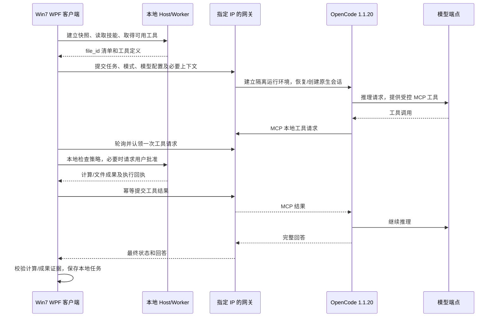

# OpenCode 内核换代：实现与交接

## 已实现范围

这是新工程的可运行候选版。真实 OpenCode 负责模型循环和会话存储；桌面端不再在远程模式下调用自研 AgentController 推理循环。原工程用于 UI、项目数据、本地办公执行和回退。

固定上游：`anomalyco/opencode`，标签 `v1.1.20`，提交 `09ff3b9bb925903b36aa35fec25394133a42cf6d`。源码在 `migration/upstream/opencode`，MIT 许可证原样保留。运行依赖 `opencode-ai=1.1.20` 由 npm lockfile 锁定；实际端到端使用官方发行二进制，未从源码重新构建上游。此标签是接口已核验的迁移基线，不代表最新版本或已完成发布前安全审计。

## 调用链

## 职责划分

- OpenCode：模型适配、多轮循环、原生会话、上游上下文管理、工具编排。
- 网关：令牌认证、协议校验、独立进程装配、持久会话位置、任务日志、工具队列及结果确认。
- `WorkAssistant.OpenCode`：Win7 可用的 HTTPS 客户端、DPAPI 连接配置、轮询、执行结果回传、本地证据判定。
- Host：输入快照、文件 ID 映射、技能白名单、审批、独立 Worker、计算中间态与成果校验。
- WPF：原有项目/对话组织、模型选择、只读分析、用户审批与交付展示。

项目与对话 SQLite 不重建；删除项目仍只是取消分组，不删除本地文件或任务。已有对话第一次进入远程内核时导入历史作为明确标记的数据；后续轮次复用 OpenCode 原生 session。远程 workspace 是会话的服务端空目录，不是用户工作区镜像，不上传原始 Office 文件。

## 工具迁移

全部 15 个已有办公工具通过动态 MCP 工具目录接入，无需逐个复制成 TypeScript 实现。客户端提交的目录已经取“所选技能 ∩ 当前模式”的交集。

OpenCode 原生 Bash、编辑、写入、搜索、读取服务器文件、内置 question 和子任务等工具默认拒绝；仅允许 `xiaolocal_*`。模型不因接入成熟内核就获得服务器通用执行权限。服务端的办公工作依然落到用户客户端。

本地 Host 增加 `LocalToolOperation/LocalToolCall` 模式，可描述工具或执行单个工具，无需初始化模型客户端；使用同一任务的输入快照、聚合 ID、文件计划和执行回执。文件变更继续使用具体操作审批，PDF 只读模式继续禁止导出。

## 协议与恢复

所有外部接口要求 `Authorization: Bearer <token>`，协议版本 1。远程客户端仅接受 HTTPS，回环地址例外。禁止自动跳转，避免访问令牌跟随重定向。

| 请求 | 行为 |
|---|---|
| `GET /health` | 网关协议及上游锁定版本；不代表已测试真实模型 |
| `POST /runs` | 提交一次任务；重复 taskId 返回 409，不重新执行 |
| `GET /runs/{id}?after=N` | 状态、增量事件、待认领工具 |
| `POST /runs/{id}/claim` | 持久化单次认领，再把调用交给客户端 |
| `POST /runs/{id}/results` | 提交回执；相同结果可重复确认，改写已确认结果返回 409 |
| `POST /runs/{id}/cancel` | 终止该任务的上游运行，不自动重放本地操作 |

MCP 使用单任务独立令牌，只能访问该任务内部工具接口，不能访问网关的其他会话或外部接口。命令内容不具备覆盖本地任务工作区、模型设置、执行模式或审批通道的权限。

客户端仅对结果确认做有限网络重试，不重复执行已认领工具。服务重启后遗留运行任务标记 interrupted，待认领/已认领请求都不重新派发。桌面重启后沿用原有中断恢复和 NeedsReview 检查。当前没有自动接续正在运行的远程任务；用户可在本地任务中心复核，随后提交新轮次。

会话按本地 session ID 的 SHA-256 建立独立目录；同一会话不并行运行。进程环境中的模型密钥在结束后从网关运行对象清空，网关 journal 不写模型凭据。OpenCode 会保存任务上下文，服务端数据目录须按用户数据管理；删除本地会话列表不会清除服务器的原生会话数据。

每次运行创建独立 OpenCode 进程，避免模型配置、MCP 令牌和执行模式在并发任务间串用。模型变更仍在下一任务生效，历史对话继续可用。代价是每轮存在进程启动成本，目前端到端验证为秒级，不宣称已优化到常驻内核的响应速度。

限制：最多 4 个并发会话、每轮 5 分钟、最多 24 次本地工具请求、HTTP 请求/响应 1 MiB、工具结果 64K 字符。网关缓存最多 1000 个 run；达到容量后拒绝新任务，需管理员按保留策略维护。显示增量最多保留 256K 字符，最终完整回答仍以完成结果为准。上游模型配置采用保守的 64K context / 8192 output 上限，不代表已核实每个模型的真实窗口；发布时应按具体模型配置。

## 本地完成证据

最终文本不直接等同于任务完成：统计类需要实际计算证据，文件生成类需要登记成果，文件整理类需要已批准并验证的变更。远程错误或本地断连后不自动重放文件操作；有变更记录时保守进入 NeedsReview。

现有技能库、项目编辑/删除、对话迁移、文件预览、应用图标和模型选择入口保留。演示模式仍走本机 Fake，关闭远程开关仍可使用原内核。

## 验证记录

已执行：

1. .NET Release 编译，0 警告、0 错误。
2. Node 协议检查：认证、非法目录/模式输入、重复工具、单次认领、重复结果确认、日志凭据隔离等断言通过。
3. 真实 OpenCode + MCP + 网关 + .NET Host + 独立 Worker：合成 CSV 按 department 汇总，导出 XLSX，完成成果校验。
4. 相同真实链路的只读分析：完成计算、零导出成果。
5. 模拟模型实际收到的工具集合仅含受控 MCP 工具，未暴露原生服务器工具。

集成结果在 `migration/verification/RESULT.txt`；合成输入、输出和状态在 `.local/integration`。这些验证不使用真实模型密钥，不读取用户办公数据，不运行 GUI。

尚未执行：Win7 真机、实际桌面交互、远程 HTTPS/证书部署、Docker 运行、真实 DeepSeek 多轮任务。最终远程部署还需要用户提供服务器地址、操作系统和部署访问条件。本机链路通过不能替代这些环境验证。

## 构建、切换与回退

新解决方案 `Xiao.OpenCode.sln`，新候选 `artifacts/opencode-candidate`。整个候选文件夹为一套客户端，不只复制 exe；Win7 仍需 .NET Framework 4.8。网关及 OpenCode 不放到 Win7 运行。

本机一键引导入口 `migration/scripts/Start-Xiao.ps1`，服务端部署入口及说明在 `migration/README.md`。脚本默认隐藏启动服务，不停止旧进程；先退出旧版及托盘。

回退可在设置中关闭远程内核，或直接使用保留的 `artifacts/agent-candidate`。没有重建用户数据库，没有修改模型默认密钥，也没有覆盖旧 release。

## 规模口径与后续维护

`migration/scripts/Count-MigrationSource.py` 分开统计自有生产代码、上游 runtime、上游其他模块和测试，排除依赖、生成代码、锁文件、文档及二进制。完整生产源码达到十万行量级；其中相当部分是上游其他客户端/库，不能算作自研或当前全部启用的功能。准确数值见 `migration/SOURCE_SCALE.md`。

维护时固定源码提交和 npm 版本；升级应同时更新锁文件、运行时版本检查、客户端 health 检查，并重跑协议和真实内核集成。网关桥接协议是独立边界，避免为跟随上游重写桌面 UI。

未完成的正式发布工作：目标 Win7/远程部署验证、上游版本发布前审计、团队多用户认证隔离、自动运行重连、完整性能评估与签名安装包。这些不因源码达到十万行而视为完成。
