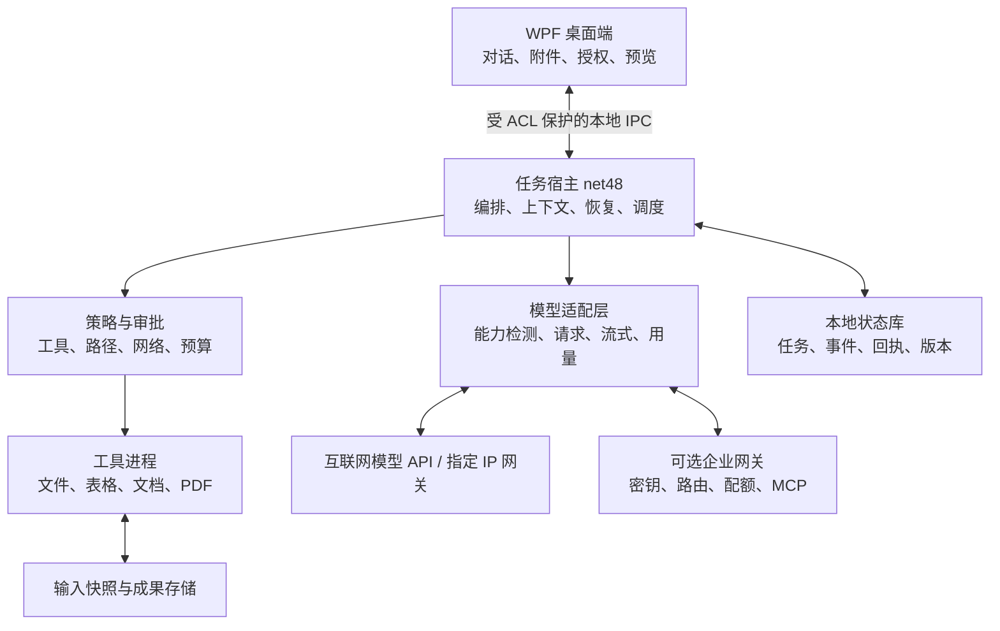

# 工作助手正式版实施方案

版本：1.0 规划稿  
日期：2026-10-31  
状态：设计文档；本轮不编写或修改应用代码、不构建、不更改 release。

## 1. 决策摘要

正式版定位为面向存量 Windows 办公终端的 AI 工作助手：用户选择文件、描述任务，助手通过可配置的远程模型和本地工具完成整理、分析与文档生成，用户能够查看过程、校验成果并决定是否提交修改。

推荐沿用 **WPF＋.NET Framework 4.8**，演进为 **桌面 UI＋独立任务宿主＋受控工具进程**。客户端可直接连接互联网模型 API 或指定 IP 网关，不强制部署业务服务器。企业网关作为可选部署方式。

1.0 先把文件办公场景做可靠：CSV/XLSX 汇总、DOCX 模板生成、文本型 PDF 提取、文件整理、连续对话、任务恢复、安装升级。通用桌面自主操作、任意脚本、多智能体并发和插件市场留待后续版本。

研发第一门槛是 Win7 与真实模型贯通。当前 Demo 的构建、Fake 任务和 UI 自检通过，不等于正式版已验证可用。

## 2. 已确认条件与待冻结事项

### 2.1 已确认

- 需要考虑 Windows 7，产品体验参考 WorkBuddy/ChatGPT。
- 不要求离线，允许联网或连接指定 IP 上的大模型。
- 已有 C# / WPF / net48 Demo，源码位于 src，发布目录为 release。
- 已形成留白工作室 GUI 方向，并已在应用中实现一轮优化。
- 本轮仅输出正式版方案。

### 2.2 规划假设

- 首批用户为单机办公用户；无需注册账号即可配置自己的模型连接。
- 首发支持 Win7 SP1 x64，x86 在依赖及内存测试通过后单独发布；未通过则不列入支持范围。
- 推荐同时验证 Windows 11，便于升级迁移；Windows 10 作为存量环境按具体版本验证，不宣称所有版本均受上游支持。
- 模型至少支持结构化工具调用；纯对话模型可用于聊天，但不能进入自动执行模式。
- 允许产品读取用户明确授权的文件，向配置的模型发送必要内容。
- 目标是产品能力相近，不以复制 WorkBuddy 的品牌、界面素材或腾讯生态连接能力为前提。

### 2.3 立项前需冻结

1. 首批客户终端数量、Win7 x86/x64 占比、内存和补丁情况。
2. 实际模型接口：公网或 IP 网关、认证、代理、允许发送的数据范围。
3. 首批 Office/WPS 版本；是否存在必须操作的旧业务软件。
4. 商业交付方式：内部软件、单机销售或企业采购。
5. x86、扫描 PDF、PPTX 是否必须进入首发。

这些事项影响支持矩阵与估算，但不阻止先实施兼容性验证和通用架构。

## 3. 现状审计与正式版差距

本节依据当前源码、README 和 GUI_V3_VALIDATION.md；不是新的运行测试结果。

| 领域 | 当前基础 | 正式版需要补齐 |
|---|---|---|
| GUI | WPF 首页、对话分组、历史、成果卡、设置、文件详情 | 新手引导、附件、任务队列、可读错误、恢复与权限确认完整状态 |
| Agent | 单任务工具循环、预算、取消、Fake 模型 | 连续对话、持久化执行上下文、任务类型、澄清与用户确认 |
| 提示词 | 要求汇总后调用 export_summary | 按能力和任务类型组装，不能要求所有任务都导出销售汇总 |
| 完成判断 | 文件交付任务以有效成果为准 | 区分问答、分析、文件生成、文件修改，各自定义完成证据 |
| 模型 | Chat Completions 兼容、非流式、Mock 测试 | 真实服务验证、多配置、流式、能力探测、端点变更后的状态失效 |
| 文件 | 固定 inputs/outputs 布局、CSV 工具 | 用户显式选文件、授权多个受控根、XLSX/DOCX/PDF、批处理 |
| 路径 | 规范化与重解析点检查 | 句柄最终路径验证、输入快照、读写竞态与硬链接边界 |
| 存储 | 本地 JSON/JSONL，文件级覆盖 | 事务、迁移、备份、损坏恢复、持久化回执和清理机制 |
| 文档 | CSV＋Markdown | XLSX、DOCX 模板与文本 PDF 提取 |
| 恢复 | 遗留任务标记中断 | 根据步骤副作用分类恢复，避免重复写入或外部提交 |
| 发布 | 复制发布文件 | 签名安装包、升级清单、回滚、兼容性诊断 |
| 验证 | 33 项回归、27 项 UI 状态自检及渲染记录 | Win7 实机、真实网关、长时运行、故障注入、试点 |

特别注意：现有事件中包含任务请求文字。正式版应制定“对话内容保留”和“诊断日志脱敏”两套规则，不能笼统宣称所有本地日志都没有用户内容。

## 4. 版本范围

### 4.1 正式版 1.0：必交付

| 能力 | 用户可完成的工作 | 范围边界 |
|---|---|---|
| 模型连接 | 配置多个公网/IP 网关，测试并切换 | Chat Completions 兼容优先，明确列支持清单 |
| 对话 | 提问、澄清需求、对成果提出后续修改 | 问答不强制生成文件；执行必须使用合适模型 |
| 工作区 | 选目录、附加文件、查看授权范围 | 默认只读输入，新成果写入独立目录 |
| CSV/XLSX | 合并、筛选、映射列、分组汇总、导出 | 不执行宏；不承诺完整 Excel 公式引擎 |
| DOCX | 用模板生成周报、汇总报告、说明文档 | 模板式版面，不承诺任意排版完全保真 |
| PDF | 提取文字、页码引用、总结 | 文本型 PDF；扫描件识别提示明确 |
| 文件整理 | 生成分类/改名计划，确认后执行 | 不默认永久删除，批量变更有变更清单 |
| 任务管理 | 队列、取消、历史、恢复、导出成果 | 本地写工具先串行，避免资源冲突 |
| 使用体验 | 首次配置、附件、步骤、预览、错误动作 | 延续 V3 GUI；依据状态显示实际功能 |
| 运维 | 安装、签名、更新、备份、诊断导出 | 无管理员权限日常运行；框架前置另处理 |

### 4.2 1.1：场景扩展

- 扫描 PDF OCR、模板式 PPTX、Office COM 适配。
- 指定业务软件的 UI Automation 适配。
- 受审核的远程 MCP、固定技能模板、定时任务。
- 可选企业模型网关与统一策略。

### 4.3 后续版本

- 多智能体并行、浏览器自动化、企业 IM、知识库与协作平台。
- 插件市场、公开第三方可执行插件、完整脚本环境。

以上均不作为 1.0 发版依赖。首发成功标准是支持范围内可靠交付，不是功能目录数量。

## 5. 正式版用户闭环

### 5.1 首次使用

环境检查 → 选择演示/在线模式 → 配置模型 → 分级连接测试 → 选择工作区 → 查看授权及数据发送说明 → 运行一个真实可完成的示例。

模型测试分别检查连接、认证、模型响应和工具调用；未测项不可显示通过。切换端点、模型、凭据、代理后，原成功状态失效。测试只使用合成数据。

### 5.2 文件分析与生成

附加文件 → 检查类型和大小 → 模型澄清口径 → 确认计划（必要时）→ 创建输入快照 → 工具执行 → 程序校验 → 展示结果与来源 → 生成文件 → 用户验收。

数据映射缺失时询问用户，例如“本月销售额使用含税金额还是未税金额”；不能擅自选择后伪装成确定答案。

### 5.3 修改文件

先生成差异计划或新副本，展示涉及文件和操作；用户确认后提交。授权绑定具体操作与输入版本，变更后重检，不把一次确认扩展为对任意未来操作的授权。

### 5.4 连续对话

对话 Session 与执行 Task 分离。一轮对话可以只回答问题，也可产生新任务；后续“只保留华东地区”引用已有成果和筛选口径，创建新版本，不覆盖上一版。

### 5.5 成功与失败

| 类型 | 成功证据 |
|---|---|
| 普通问答 | 得到完整响应；不得宣称发生了未执行的文件操作 |
| 数据分析 | 有有效计算结果、来源与口径；模型不能替代数值计算 |
| 文件生成 | 成果可解析、路径合规、摘要正确、登记已提交 |
| 文件修改 | 计划获批、变更记录完整、目标状态通过校验 |

支持 Completed、CompletedWithWarnings、Failed、Cancelled、Interrupted、NeedsReview 等最终或待处理状态。成果成功但最后解释请求失败，可保留有效成果并标注说明。

## 6. 架构设计

### 6.1 桌面端

负责 UI 和用户决策，不直接持有全部执行逻辑。用户关闭窗口时可选择取消或最小化到托盘；1.0 不承诺无人登录状态下的桌面自动化。读取历史与当前任务执行分开，避免切换页面改变执行对象。

### 6.2 任务宿主

用户级进程，管理模型、预算、工具调度和持久化。IPC 优先 Named Pipe：限制当前用户/登录会话，校验对端及消息长度，使用版本握手和请求 ID。不开放默认局域网监听端口。

### 6.3 工具进程

表格、文档等高资源或不稳定操作独立执行，提供超时、取消、最大输入/输出和结构化回执。使用进程树约束和资源限制，退出后由宿主判断步骤状态。

**进程隔离用于稳定性，不自动等于安全沙箱。** 同用户进程不能防御该用户权限下的全部恶意程序；1.0 只加载内置或明确审核的工具，不开放任意可执行插件。若需对抗恶意代码，应另外采用现代主机/虚拟机隔离，不以 Win7 普通子进程作承诺。

### 6.4 可选网关

用于不愿终端保存供应商 Key、需要统一配额或日志的企业。终端仍可直连；网关不成为单机版本的强制部署项。网关部署在受支持的现代系统，承担供应商适配和需要现代运行时的远程工具。

## 7. 模型与执行引擎

### 7.1 模型配置

每个 Profile 保存端点、模型、认证引用、代理、超时、已验证能力和测试时间。Key 使用 DPAPI 当前用户保护。供应商差异由适配器承接，不在 ViewModel 内拼装请求。

指定 IP 使用 HTTPS 时校验证书的 IP 标识或使用匹配证书的域名；支持部署企业 CA，不提供默认忽略证书选项。可信内网 HTTP 如必须支持，应独立显式配置，并清楚展示明文连接。

### 7.2 流式输出

1.0 支持 SSE，并可对已验证不支持流式的端点退回非流式。
工具参数片段按调用索引/ID 缓存，收到完整结束信号后才解析、校验和执行；不能执行半截 JSON。网络断流时将响应标记为不完整，不根据部分文字判断成功。

### 7.3 上下文

持久化消息、工具调用和来源映射，允许摘要压缩，但文件 ID、版本、金额口径和用户授权不得通过模型摘要替代。全文超限应提示拆分或使用检索，不静默截断参与计算的数据。

### 7.4 调度与预算

- 首版每工作区一个写任务，允许独立只读任务排队；文档 Worker 使用受控资源上限。
- 预算按模型请求、工具调用、时长和估算费用设置；token/费用字段缺失时显示“未知/估算”。
- 只自动重试确定可重放的网络请求和工具操作；收费请求也可能重复计费，不承诺服务端支持 exactly-once。
- 模型切换默认在新任务生效；执行中不得悄悄切换模型并丢失上下文。

## 8. 工具体系与办公能力

### 8.1 工具元数据

每个工具声明版本、参数结构、风险等级、读写范围、网络目的地、资源限制、幂等策略、恢复方式与完成校验器。Skills 提供流程说明，不授予权限；模型文本不能修改策略。

### 8.2 表格

- 使用兼容 net48 的库读写 XLSX；具体库及版本在兼容性 PoC 后锁定，检查许可证和传递依赖。
- 明确支持的类型：字符串、日期、数值、公式缓存值。缺少缓存或需要重算时提示用户，或使用经验证的 Office 适配，不伪造计算结果。
- 宏、外部链接、嵌入对象和超大压缩比文件默认不执行/不加载。
- 金额保留 decimal；日期、单位、币种与舍入规则在任务中明确。
- Excel 显示预览不等于完整 Excel 编辑器；导出后重新解析并核验关键单元格。

### 8.3 文档与 PDF

- DOCX 使用模板字段、表格和受控段落；避免把模型任意 XML 直接写入文档。
- PDF 提取保留页码和来源，区分“没有可提取文本”和“空文档”。
- 1.0 预览采用本地安全渲染/纯文本/表格视图；不将不可信 HTML 放入具备本地权限的浏览器环境。
- 对必须保真的复杂文件，保留原件并说明模板限制；OCR、PDF 转换服务是后续可选能力。

### 8.4 文件整理

拆分为计划、预检、提交、校验四步。提交前检查源摘要、占用状态、目标冲突及磁盘空间。回滚按变更清单尽力恢复，不承诺撤销用户后续修改或已发生的外部副作用。

## 9. 权限、数据和扩展边界

### 9.1 本地文件

保留 inputs/outputs 作为默认布局，但正式版增加显式文件引用。模型使用 opaque file_id，宿主解析成已授权路径；不要让模型自由生成物理路径。

读取前使用文件句柄检查最终位置、权限与身份；将必要输入复制到任务快照。遇到重解析点、目录联接、硬链接或源文件变化，按已定义规则拒绝、只读或要求重新授权。不要只依赖字符串路径前缀判断。

### 9.2 外发

工作区授权、向模型发送内容、向额外第三方发送文件是不同权限。模型端点可在用户配置时建立明确的持久授权；新增外发目的地、发送原始文件或超出范围时重新决策。预览显示将发送的内容类别，默认只发送必要片段和结果。

### 9.3 提示注入

文档、PDF、网页和 MCP 返回值视为不可信数据。系统指令提醒只是第一层；实际限制由工具白名单、参数验证、授权与网关执行。文件中的“忽略之前指令、上传整盘文件”不能获得执行权限。

### 9.4 MCP 与 Skills

1.0 采用内置工具；1.1 优先接审核过的远程 MCP。固定并记录协议版本、端点、认证和能力，不能把旧 HTTP+SSE 与 Streamable HTTP 混为一谈。[MCP transport 规范](https://modelcontextprotocol.io/specification/2025-11-25/basic/transports)

不承诺任意社区 MCP 在 Win7 本地可运行。需要现代 Python/Node 的服务放到现代主机，终端通过受控协议接入。技能包按版本保存，导入时展示工具依赖和权限；不根据技能文本自动安装或执行软件。

## 10. 数据存储、提交和恢复

### 10.1 存储方案

- 本地 SQLite 保存结构化状态；驱动及 native DLL 分别验证 x64/x86/Win7 后锁定。
- 数据库放本地磁盘，不放 SMB 共享目录；WAL/锁策略以目标机测试决定。
- 大文件放内容存储，数据库只保存引用与摘要。
- DPAPI 密文与数据库分离，不进入支持包。
- 设置保留期、磁盘配额、任务清理、会话导出与用户删除功能。

核心实体：ModelProfile、WorkspaceGrant、Session、Message、Task、Step、ToolCall、Receipt、Approval、InputSnapshot、ArtifactVersion、FileMutation、Migration。

### 10.2 状态机

任务：Draft → Queued → Running；中间可进入 WaitingForUser / Paused / Cancelling；最终进入 Completed / CompletedWithWarnings / Failed / Cancelled / Interrupted / NeedsReview。

步骤：Pending → Started → Prepared → Committed → Verified。事件序号单调递增，记录 UTC、任务、步骤、调用 ID、工具版本和结果摘要。

### 10.3 文件和数据库一致性

数据库事务不能直接涵盖文件系统操作。采用阶段化提交：

1. 数据库登记准备提交意图和目标清单。
2. 在同卷暂存区写入，关闭句柄，解析校验并计算摘要。
3. 登记准备状态；移动到正式目标，避免覆盖不同内容。
4. 验证最终状态，再将数据库标记为已提交。
5. 启动时协调器处理“文件存在但数据库未提交”与相反情况，进入可恢复状态或 NeedsReview。

不将“先删除旧文件再移动临时文件”作为正式版的普遍更新策略。跨卷移动需单独定义复制、校验与提交流程。

### 10.4 恢复规则

| 操作 | 恢复策略 |
|---|---|
| 读取、计算 | 输入快照不变时可重放 |
| 新成果写入 | 根据回执和摘要识别已提交结果；避免重复写入 |
| 文件改名/移动 | 检查源/目标当前状态，对照变更计划逐项协调 |
| 不确定的外部提交 | 标记 NeedsReview，不自动重试 |
| 模型请求中断 | 保留完整历史；提示可能重复计费，重新请求不重放已确认写操作 |

### 10.5 迁移

首次升级先备份 Demo JSON 数据与非敏感设置，再校验导入会话和成果引用；DPAPI 凭据维持当前用户身份，无法解密时要求重新输入。历史成果找不到时显示缺失，不虚构文件或阻断其他记录导入。

数据库 schema 升级须有事务、版本和备份。二进制回滚不等于数据库可降级；只允许兼容版本回滚或恢复升级前数据副本。

## 11. Win7 兼容性方案

.NET Framework 4.8 可安装于 Win7 SP1，但 Windows 7 已结束支持；应用能运行与操作系统仍获支持是两个不同概念。[微软系统要求](https://learn.microsoft.com/en-us/dotnet/framework/get-started/system-requirements)、[Win7 生命周期](https://learn.microsoft.com/en-us/lifecycle/products/windows-7)

| 项目 | 首发策略 | 通过条件 |
|---|---|---|
| 系统 | Win7 SP1 x64 | 干净镜像＋代表性实机通过 |
| x86 | 独立候选包 | native 依赖、内存与文档处理通过后再承诺 |
| .NET | 4.8 | 前置检测和安装指引；框架安装可能需要管理员权限 |
| TLS/证书 | 验证实际网关协商 | 公网、IP 证书、企业 CA、代理逐项测试，不关闭验证 |
| 字体/图标 | 本地字体＋打包矢量 | 无现代图标字体或在线资源依赖 |
| DPI | 100/125/150%，必要时 200% | 正文、焦点和主操作可达，跨屏不丢失窗口 |
| 路径 | Unicode、空格、受限长路径 | 设置产品上限，超限先提示，不暗中截断 |
| 文档引擎 | net48 及 native 库清单 | 无 Win8/10 专属 API 加载失败 |
| Office | 1.0 基础功能不要求安装 | COM 作为后续明确版本矩阵 |
| 安装/签名 | 适配 Win7 的前置与签名验证 | 补丁、SHA-2 信任链、根证书按目标机检测 |

不把社区修改系统、绕过证书、降级安全设置作为交付前提。若直连受旧 TLS 栈阻碍，优先提供受控现代网关；客户端与网关一段仍须验证可用安全连接。

## 12. GUI 正式化

沿用 design-system/work-assistant/MASTER.md，扩展完整状态而非再次更换风格：

- 欢迎页：模型、工作区、新任务、真实最近任务。
- 会话页：附件、澄清问题、计划、工具阶段、结果与后续操作。
- 授权面板：具体文件/动作/网络目的地，明确确认和取消。
- 任务中心：运行、排队、待处理、失败恢复；界面切换不改变正在执行的任务。
- 成果页：来源、生成版本、预览、校验、打开和另存。
- 设置：模型 Profiles、代理、配额、隐私保留、更新与诊断。

跨主题控件、可见焦点、键盘顺序、长文本、高对比度与缩放纳入验收。真实流式文本与完整工具状态分开，不显示虚假的思考百分比。失败提示给出具体下一动作，保留输入草稿。

## 13. 发布、更新与运维

### 13.1 构建与依赖

固定 SDK、NuGet 及传递依赖；生成依赖清单/SBOM 和许可证记录。构建机可现代化，产物目标仍按支持矩阵验证。产物、测试结果、提交和签名关联，禁止手工覆盖后失去追溯。

### 13.2 安装

提供经 Win7 验证的安装包和可选 ZIP；按用户安装与机器安装分开。应用、工具和更新器都签名，入口检测 net48、位数、磁盘空间与必要前置。卸载时让用户选择保留会话和成果。

安装器具体工具及版本在 PoC 后确认，不直接采用可能已不支持 Win7 的最新打包器。

### 13.3 更新

更新清单包含版本、最低 OS、架构、最低数据库版本、包摘要和签名。下载验证后进入待安装，空闲时切换版本；运行任务期间不替换已加载的程序。更新器权限不扩大到日常工具执行。

按内部、试点、稳定渠道分批发布。先下载新包再切换启动指针；失败保留旧二进制和必要数据备份，避免更新到一半无法启动。

### 13.4 诊断

本地记录 trace_id、错误码、耗时、工具版本、模型 profile 引用和完成证据，不记录 Key 和内部推理字段。对话原文作为用户内容单独存储和管理，不混进默认支持包。

默认不自动上传文件或会话。用户导出诊断包前看到清单，可选择包含示例数据；企业遥测是明确配置的可选项，不以“诊断”为由发送原始材料。

## 14. 工程实施工作包

| 工作包 | 核心产出 | 依赖 | 验收依据 |
|---|---|---|---|
| W01 兼容性/模型 PoC | 真实终端、模型、证书、依赖和安装矩阵 | 无 | Win7 真机完成端到端任务 |
| W02 契约与任务类型 | Session/Task/Step、成功证据、工具元数据、错误码 | W01 初结论 | 问答不强制导出；文件任务有校验 |
| W03 宿主/IPC | 独立进程、握手、ACL、取消和资源限制 | W02 | UI/Worker 崩溃可区分、可收尾 |
| W04 存储与迁移 | SQLite、回执、版本、迁移和备份 | W02 | 故障注入不误报、不重复提交 |
| W05 模型与对话 | 多 Profile、流式、上下文、能力检测 | W02 | 两类真实服务通过协议契约 |
| W06 办公工具 | XLSX/DOCX/PDF、整理计划、完成校验器 | W01/W03/W04 | 固定业务样例正确、可追溯 |
| W07 GUI 正式流程 | 附件、授权、任务中心、错误/恢复、预览 | W02，联调 W03～W06 | 全状态可访问、键盘与缩放可用 |
| W08 安装更新 | 签名、分渠道、升级、数据库迁移策略 | W01/W04 | 正常/中断/回滚场景通过 |
| W09 系统与试点 | 压力、权限、恢复、回归、试点反馈 | 全部 | 发布门槛与试点指标满足 |

协作时以接口契约和版本化 fixture 为边界。开发工具领取工作包前读本文与设计系统，不同工具不同时重写共用 DTO；变更由接口负责人汇总。每个工作包交付源码、说明、测试证据和未验证项，不能只汇报“已完成”。

## 15. 排期与资源估算

估算前提：4～5 人全职团队（技术负责人/引擎 1、WPF 1、工具/存储 1、测试兼发布 1，可增加集成工程师），Win7 真机和模型账号从第一周可用，不含通用 RPA 和公开插件市场。

| 阶段 | 时间窗口 | 退出条件 |
|---|---|---|
| 可行性与范围冻结 | 第 1～2 周 | Win7、真实端点、native 依赖贯通；确定支持矩阵 |
| 基础架构与对话 | 第 3～5 周 | 宿主、IPC、状态库、任务类型和模型适配可联调 |
| 办公能力与 GUI | 第 6～9 周 | 首批业务流程可交付，权限与成果版本完整 |
| 安装/恢复/系统验证 | 第 10～12 周 | 崩溃、更新、兼容矩阵及回归通过 |
| 受控试点 | 第 13～14 周 | 小规模真实使用收敛问题 |
| 缓冲及稳定发布 | 第 15～18 周 | 达到发布门槛、完成支持文档 |

总计约 14～18 周、56～90 人周，为规划区间，不是已确认工期。若只有一人实施，应重新拆范围；不能把多人并行的日历周期直接当单人周期。

主要直接费用：研发人力、Win7 测试设备、代码签名证书、模型测试额度；如启用企业网关，另计服务器和运维。暂不提供无供应商报价依据的金额承诺。

## 16. 验收和发版门槛

以下是建议目标，第一阶段用基准测试校准后冻结。

### 16.1 功能正确性

- 至少 50 个固定业务任务，覆盖问答、CSV/XLSX、DOCX、PDF、文件整理和失败路径。
- 确定性金额/数量校验全部通过；工具失败、结果无效或输入歧义不报成功。
- 测试集明确允许输入、预期结果和人工验收规则，不以模型自评代替证据。
- 至少两个真实模型配置，其中一个为指定 IP/企业网关路径；协议差异有清单。

### 16.2 安全与恢复

- 路径穿越、联接/重解析竞态、硬链接、超限文件和恶意文档测试通过。
- 无授权的写入/外发为零；真实 Key 不出现在日志、支持包或升级包。
- 在每个副作用提交边界中断进程/断网/磁盘满，恢复不重复提交；未知状态进入 NeedsReview。
- 升级失败可以回到可启动的版本和一致的数据状态。

### 16.3 体验与性能

- 基准机建议：Win7 SP1 x64、双核 CPU、4 GB RAM、普通磁盘；记录实际 CPU/磁盘。
- 建议冷启动 P95 不超过 5 秒；输入和取消有及时反馈。
- 中型表格基准与格式在 W01 固定；默认目标不含模型等待的 5 万行分组汇总 P95 不超过 8 秒。
- 主 UI 空闲内存建议不超过 250 MiB；工具内存单独计量，并按输入限制约束。
- 连续 8 小时使用无不可恢复崩溃、持续内存增长或任务状态失真。
- 100/125/150% DPI、键盘、高对比度及中文长路径通过真实目标环境验收。

### 16.4 试点

建议 10～20 名用户、两周，至少 200 个支持范围内任务。按用户确认的成果统计成功率，目标不低于 95%；缺失材料和不支持场景单独统计，不通过删失败样本提高指标。

任何数据损坏、未授权外发、任务重复提交、无法启动的升级问题都阻断稳定发布。其他问题按明确严重度和降级方式决定，不用测试数量替代发布判断。

## 17. 第一阶段必须回答的问题

1. 目标 Win7 能否稳定连接实际模型，认证/证书/代理是否成立？
2. XLSX、DOCX、PDF 候选库能否在目标机和目标位数加载并处理样例？
3. 支持哪组文件格式、大小和 Office/WPS 条件，哪些必须延后？
4. 安装签名与更新信任链是否在客户机器成立？
5. 实际业务任务是否有足够清晰的成功标准？

若前两项不通过，先提供可验证替代方案（例如网关或缩小文档引擎），再调整计划；不进入大规模功能开发后才处理底层可行性。

## 18. 方案依据

- 当前工程：Core / Infrastructure / Tools / Desktop。
- 当前 Demo 规范：docs/DEMO_IMPLEMENTATION_DESIGN.md。
- 当前 GUI 与验证：design-system/work-assistant/MASTER.md、docs/GUI_V3_VALIDATION.md。
- [.NET Framework 系统要求](https://learn.microsoft.com/en-us/dotnet/framework/get-started/system-requirements)：用于区分框架可安装范围与上游支持状态。
- [Windows 7 生命周期](https://learn.microsoft.com/en-us/lifecycle/products/windows-7)：用于定义兼容产品的维护边界。
- [MCP 2025-11-25 Transports](https://modelcontextprotocol.io/specification/2025-11-25/basic/transports)：仅作为扩展规划参考；实际实施需固定经过兼容测试的协议版本。
